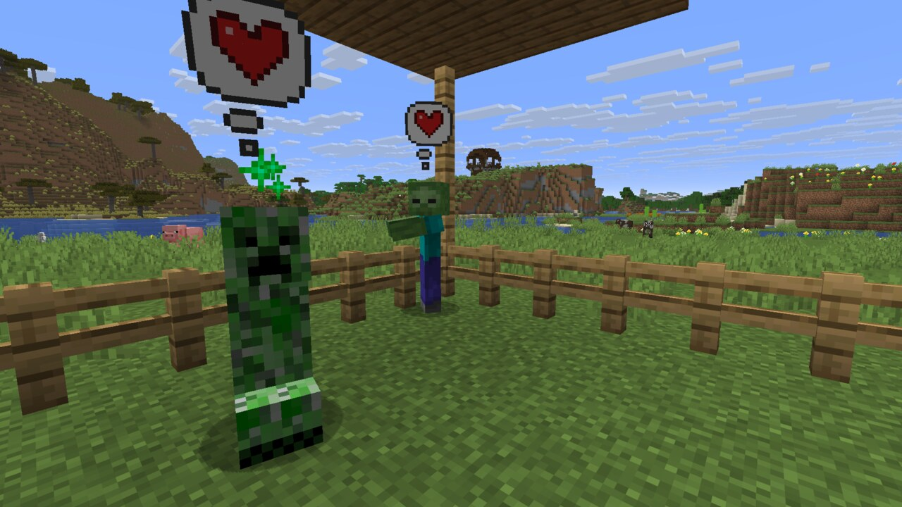

# Kid Mode

**A gentler Minecraft world for young players**, made for [Horizon](https://playhorizon.dev).

Kid Mode takes the fear out of the game without taking the game away. Monsters still roam the world, but
they leave you alone. You can't get hurt, animals can't be hurt, and the mobs you'd normally fight can be
befriended instead, tamed and kept as pets that bring you useful things.

It's meant for children who want to build, explore and play with the creatures of the world, and for
parents who'd like them to do that without the scary parts.

## What it does

- **You can't get hurt.** No damage from mobs, falls, fire, lava, drowning or explosions, and no starving.
- **Monsters are friendly.** Zombies, skeletons, creepers, spiders and the rest, even the bosses, never
  chase or attack you. Endermen don't mind being looked at, and wolves, bees and other neutral mobs stay calm.
- **Animals can't be hurt.** Cows, pigs, sheep, horses, fish and the other animals are safe from everything.
- **Tame monsters and animals.** Feed a creature the food it likes (raw meat for a zombie, a flower for a
  creeper, a golden carrot for a cow) and it may become yours. A tamed creature stays where it is, never
  disappears, sparkles now and then, and every few minutes drops something useful: string, bones,
  gunpowder, leather and more.
- **Taming hints.** Look at a creature and a little thought bubble shows what food it likes, or a heart once
  it's tamed. A creature someone else tamed shows that player's face, so everyone can tell whose pet it is.
- **Optional extras**, off unless you turn them on: sunny weather all the time, nights that pass by
  themselves, monsters that can't be hurt either, and an Ender Dragon that can't be hurt.

Every feature can be turned on or off on the mod's settings page in the game (**Options > Mods > Kid Mode**).
The mod speaks English and Polish. The full list of features and their settings is in
[docs/features.md](docs/features.md).

## What works today

Kid Mode 0.11 runs on the newest Horizon. Everything in the list above works, in single player and when
friends join your world. Some smaller touches from earlier versions aren't possible on the new Horizon yet:

- Leads can't be put on monsters, only on the animals the game normally allows.
- Undead monsters still catch fire in daylight (it doesn't hurt them).
- The Elder Guardian's curse still reaches you, and the Ender Dragon still swoops and breathes at you,
  although nothing it does can hurt you.
- The thought bubble grows in and out instead of fading.

## Planned

- Bring back the smaller touches above as soon as Horizon makes them possible.
- Make more creatures from other mods friendly and tameable. Today Kid Mode covers the game's own mobs.
- Publish Kid Mode in Horizon's mod list, so it can be installed with one click.

## Installing

Kid Mode needs the [Horizon launcher](https://playhorizon.dev). On its **Mods** page, choose **Add from
GitHub** and paste this page's address, then **Build**. Turn the features you want on or off in the game's
**Options > Mods > Kid Mode**.

Building it yourself, and how it works inside: [docs/development.md](docs/development.md).

## Licence

Copyright © 2026 veinmine. Kid Mode is free software under the GNU General Public License, version 3 or
(at your option) any later version; see [LICENSE](LICENSE).
